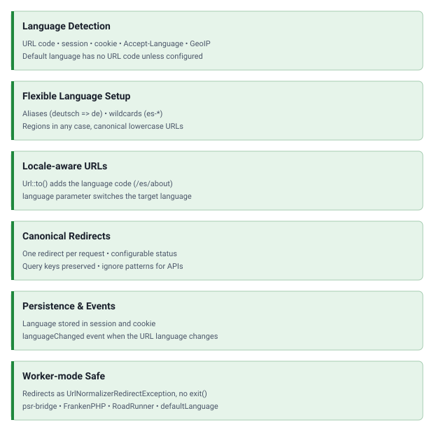

<!-- markdownlint-disable MD041 -->
<p align="center">
    <picture>
        <source media="(prefers-color-scheme: dark)" srcset="https://www.yiiframework.com/image/design/logo/yii3_full_for_dark.svg">
        <source media="(prefers-color-scheme: light)" srcset="https://www.yiiframework.com/image/design/logo/yii3_full_for_light.svg">
        
    </picture>
    <h1 align="center">Locale URLs</h1>
    <br>
</p>
<!-- markdownlint-enable MD041 -->

<p align="center">
    <a href="https://github.com/yii2-extensions/localeurls/actions/workflows/build.yml" target="_blank">
        
    </a>
    <a href="https://github.com/yii2-extensions/localeurls/actions/workflows/static.yml" target="_blank">
        
    </a>
    <a href="https://github.com/yii2-extensions/localeurls/actions/workflows/security.yml" target="_blank">
        
    </a>
</p>

<p align="center">
    <strong>Language detection, persistence, and locale-aware URLs for Yii2 applications</strong>
</p>

## Features

<picture>
    <source media="(min-width: 768px)" srcset="./docs/svgs/features.svg">
    
</picture>

Worker-mode requirements (sessions, cookies, event handlers) are listed in the
[configuration guide](docs/configuration.md#worker-mode).

### Installation

```bash
composer require yii2-extensions/localeurls:^0.2
```

To use the development line, require `^0.2@dev`.

### Quick start

#### How it works

1. Detects the language from the URL path (`/es/about` sets Spanish).
2. Falls back to the persisted language, then to browser headers or GeoIP, then to the default language.
3. Adds the language code to generated URLs, except for the default language (see `enableDefaultLanguageUrlCode`).
4. Remembers the choice in session and cookie.

#### Basic configuration

Replace the `urlManager` component in `config/web.php`. The application language is the default language, which has
no code in the URL; the `defaultLanguage` property of the manager sets it explicitly.

```php
<?php

declare(strict_types=1);

use yii2\extensions\localeurls\UrlLanguageManager;

return [
    'language' => 'en',
    'components' => [
        'urlManager' => [
            'class' => UrlLanguageManager::class,
            'languages' => ['en', 'es', 'fr', 'de'],
            'enablePrettyUrl' => true,
            'showScriptName' => false,
            'rules' => [
                '' => 'site/index',
                '<controller:\w+>/<action:\w+>' => '<controller>/<action>',
            ],
        ],
    ],
];
```

#### Automatic URL generation

```php
<?php

declare(strict_types=1);

use yii\helpers\Url;

// Current language `en`, the default language.
Url::to(['site/about']); // /site/about
// Current language `es`, set by a request such as /es/site/index.
Url::to(['site/about']); // /es/site/about
// Another language.
Url::to(['site/contact', 'language' => 'fr']); // /fr/site/contact
```

## Documentation

Practical guides and examples for language-aware URLs and worker isolation.

- 📚 [Installation Guide](docs/installation.md)
- ⚙️ [Configuration Guide](docs/configuration.md), including
  [worker mode](docs/configuration.md#worker-mode)
- 💡 [Usage Examples](docs/examples.md)
- 🔄 [Upgrade Guide](UPGRADE.md)
- 🧪 [Testing Guide](docs/testing.md)

## AI assistance

AI agents: use the repository guides and source for the installed revision.
For a [documentation deployment](https://yii2-framework.github.io/docs/) with
`llms.txt`, read that index first. When Markdown export is enabled, append
`index.md` to a page URL. For Yii conventions, use the `yii2-framework` skill
from a local framework documentation checkout.

- 🤖 [yii2-localeurls-configuration skill](docs/agents.md): installation for
  Claude Code, Codex, and OpenCode.

If the hosted sources are unavailable, use the repository guides and locally available skills.

## Package information

[](https://www.php.net/releases/8.3/en.php)
[](https://packagist.org/packages/yiisoft/yii2)
[](https://github.com/yiisoft/yii2/tree/22.0)
[](https://packagist.org/packages/yii2-extensions/localeurls)
[](https://packagist.org/packages/yii2-extensions/localeurls)

## Project status

[](https://codecov.io/github/yii2-extensions/localeurls)
[](https://github.com/yii2-extensions/localeurls/actions/workflows/static.yml)
[](https://github.com/yii2-extensions/localeurls/actions/workflows/quality.yml)
[](https://github.styleci.io/repos/711867018?branch=main)

## Our social networks

[](https://x.com/Terabytesoftw)
[](https://www.facebook.com/wilmer.arambula.9)
[](https://www.reddit.com/r/Yii2/)
[](https://t.me/yii_framework_in_english)

## Credits

This package started as a fork of [codemix/yii2-localeurls](https://github.com/codemix/yii2-localeurls).

## License

[](LICENSE)
