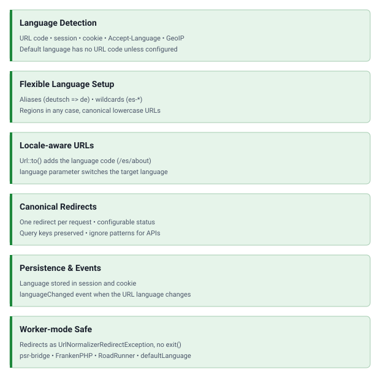

<!-- markdownlint-disable MD041 -->
<p align="center">
    <picture>
        <source media="(prefers-color-scheme: dark)" srcset="https://www.yiiframework.com/image/design/logo/yii3_full_for_dark.svg">
        <source media="(prefers-color-scheme: light)" srcset="https://www.yiiframework.com/image/design/logo/yii3_full_for_light.svg">
        
    </picture>
    <h1 align="center">Locale URLs</h1>
    <br>
</p>
<!-- markdownlint-enable MD041 -->

<p align="center">
    <a href="https://github.com/yii2-extensions/localeurls/actions/workflows/build.yml" target="_blank">
        
    </a>
    <a href="https://codecov.io/github/yii2-extensions/localeurls" target="_blank">
        
    </a>
    <a href="https://dashboard.stryker-mutator.io/reports/github.com/yii2-extensions/localeurls/main" target="_blank">
        
    </a>
    <a href="https://github.com/yii2-extensions/localeurls/actions/workflows/static.yml" target="_blank">
        
    </a>
</p>

<p align="center">
    <strong>Language detection, persistence, and locale-aware URLs for Yii2 applications</strong>
</p>

## Features

<picture>
    <source media="(min-width: 768px)" srcset="https://raw.githubusercontent.com/yii2-extensions/localeurls/main/docs/svgs/features.svg">
    
</picture>

Worker-mode requirements (sessions, cookies, event handlers) are listed in the
[configuration guide](https://github.com/yii2-extensions/localeurls/blob/main/docs/configuration.md#worker-mode).

### Installation

```bash
composer require yii2-extensions/localeurls:^0.2
```

### Quick start

#### How it works

1. Detects the language from the URL path (`/es/about` sets Spanish).
2. Falls back to the persisted language, then to browser headers or GeoIP, then to the default language.
3. Adds the language code to generated URLs, except for the default language (see `enableDefaultLanguageUrlCode`).
4. Remembers the choice in session and cookie.

#### Basic configuration

Replace the `urlManager` component in `config/web.php`. The application language is the default language, which has no
code in the URL; the `defaultLanguage` property of the manager sets it explicitly.

```php
<?php

declare(strict_types=1);

use yii2\extensions\localeurls\UrlLanguageManager;

return [
    'language' => 'en',
    'components' => [
        'urlManager' => [
            'class' => UrlLanguageManager::class,
            'languages' => ['en', 'es', 'fr', 'de'],
            'enablePrettyUrl' => true,
            'showScriptName' => false,
            'rules' => [
                '' => 'site/index',
                '<controller:\w+>/<action:\w+>' => '<controller>/<action>',
            ],
        ],
    ],
];
```

#### Automatic URL generation

```php
<?php

declare(strict_types=1);

use yii\helpers\Url;

// Current language `en`, the default language.
Url::to(['site/about']); // /site/about
// Current language `es`, set by a request such as /es/site/index.
Url::to(['site/about']); // /es/site/about
// Another language.
Url::to(['site/contact', 'language' => 'fr']); // /fr/site/contact
```

## Documentation

Practical guides and examples for language-aware URLs and worker isolation.

- 📚 [Installation Guide](https://github.com/yii2-extensions/localeurls/blob/main/docs/installation.md)
- ⚙️ [Configuration Guide](https://github.com/yii2-extensions/localeurls/blob/main/docs/configuration.md), including
  [worker mode](https://github.com/yii2-extensions/localeurls/blob/main/docs/configuration.md#worker-mode)
- 💡 [Usage Examples](https://github.com/yii2-extensions/localeurls/blob/main/docs/examples.md)
- 🔄 [Upgrade Guide](UPGRADE.md)
- 🧪 [Testing Guide](https://github.com/yii2-extensions/localeurls/blob/main/docs/testing.md)

The guides and the [API reference](https://yii2-framework.github.io/docs/extensions/localeurls/reference/) generated
from the PHPDoc in `src/` are published at <https://yii2-framework.github.io/docs/extensions/localeurls/>.

## AI assistance

AI agents: read the [documentation index](https://yii2-framework.github.io/docs/llms.txt) and fetch the Markdown version
of a page by appending `index.md` to its URL. The
[AI agents guide](https://yii2-framework.github.io/docs/project/ai-agents/) covers skill installation, client setup and
verification.

- 🤖 [`yii2-localeurls-configuration` skill](https://github.com/yii2-extensions/localeurls/blob/main/docs/agents.md):
  language URL aliases, default language, detection and persistence, canonical redirects, the `languageChanged` event,
  and request isolation in long-running workers.
- 🧭 [`yii2-framework` skill](https://yii2-framework.github.io/docs/guide/skills/yii2-framework/): Yii 22.0 application
  conventions.

The hosted documentation covers Yii 22.0. If it does not match the installed revision or is unavailable, use the
[repository guides](#documentation), the [skill source](skills/yii2-localeurls-configuration/SKILL.md), the source
PHPDoc and the [changelog](CHANGELOG.md).

## Package information

[](https://www.php.net/releases/8.3/en.php)
[](https://github.com/yiisoft/yii2/releases/tag/2.0.55)
[](https://github.com/yiisoft/yii2/tree/22.0)
[](https://packagist.org/packages/yii2-extensions/localeurls)
[](https://packagist.org/packages/yii2-extensions/localeurls)

## Project status

[](https://github.com/yii2-extensions/localeurls/actions/workflows/static.yml)
[](https://github.com/yii2-extensions/localeurls/actions/workflows/quality.yml)
[](https://github.styleci.io/repos/711867018?branch=main)

## Security

[](https://scorecard.dev/viewer/?uri=github.com/yii2-extensions/localeurls)
[](https://github.com/yii2-extensions/localeurls/actions/workflows/security.yml)

## Built with AI

[](https://claude.com/claude-code)
[](https://openai.com/codex)
[](https://www.coderabbit.ai)

## Our social networks

[](https://x.com/Terabytesoftw)
[](https://www.facebook.com/wilmer.arambula.9)
[](https://www.reddit.com/r/Yii2/)
[](https://t.me/yii_framework_in_english)

## Credits

This package started as a fork of [codemix/yii2-localeurls](https://github.com/codemix/yii2-localeurls).

## License

[](LICENSE)
